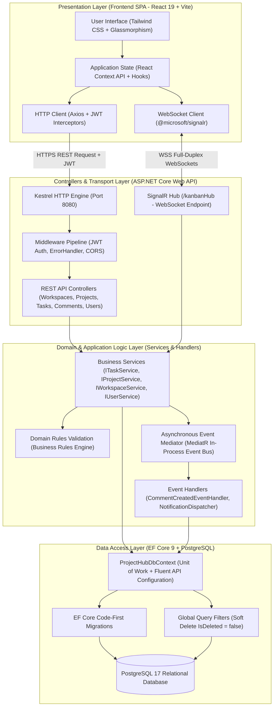
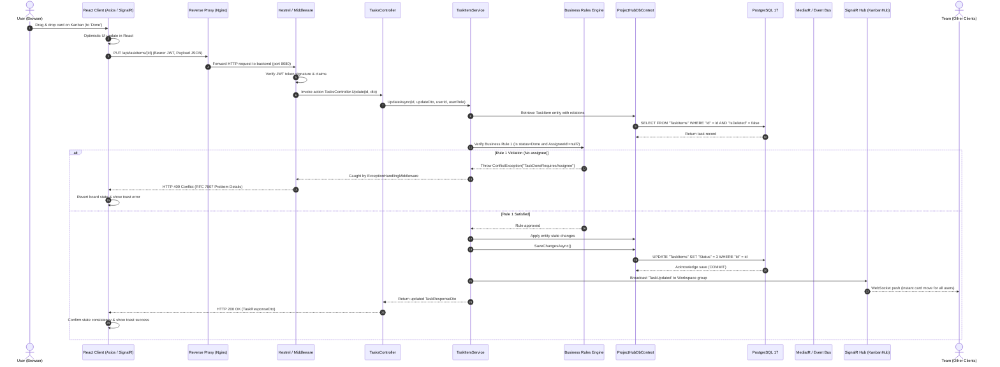
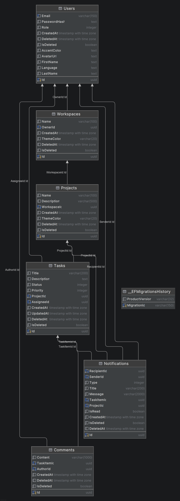
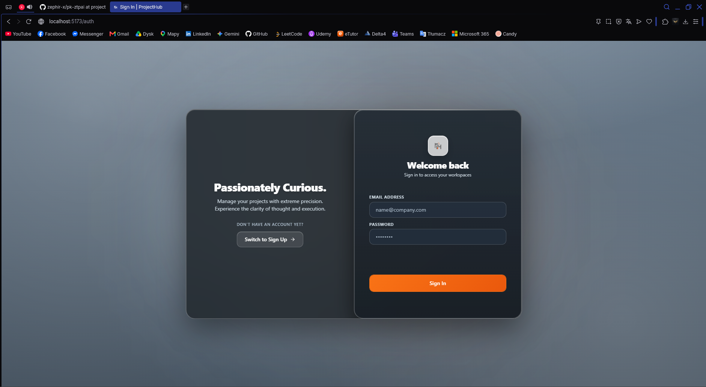
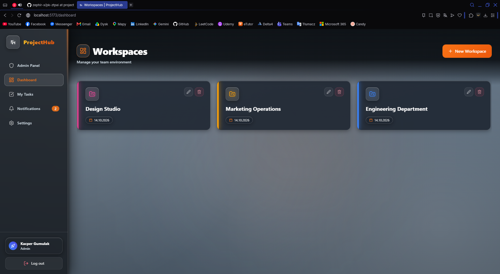
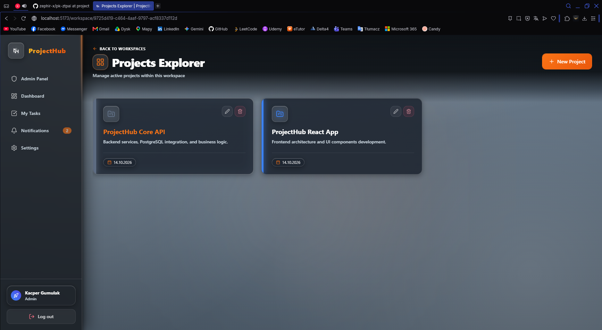
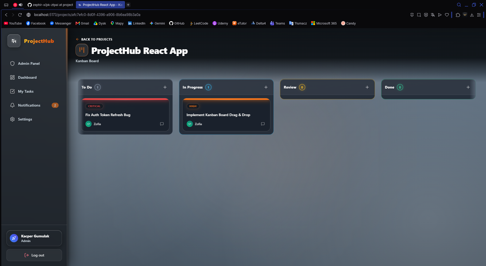
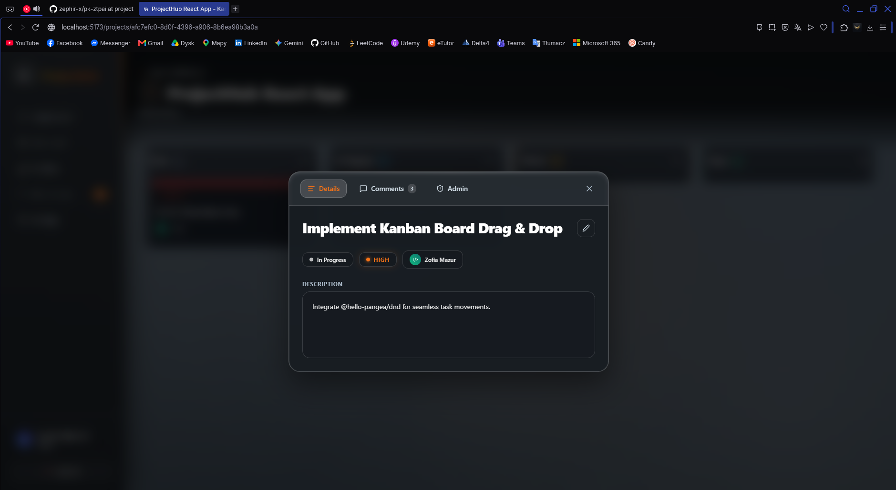
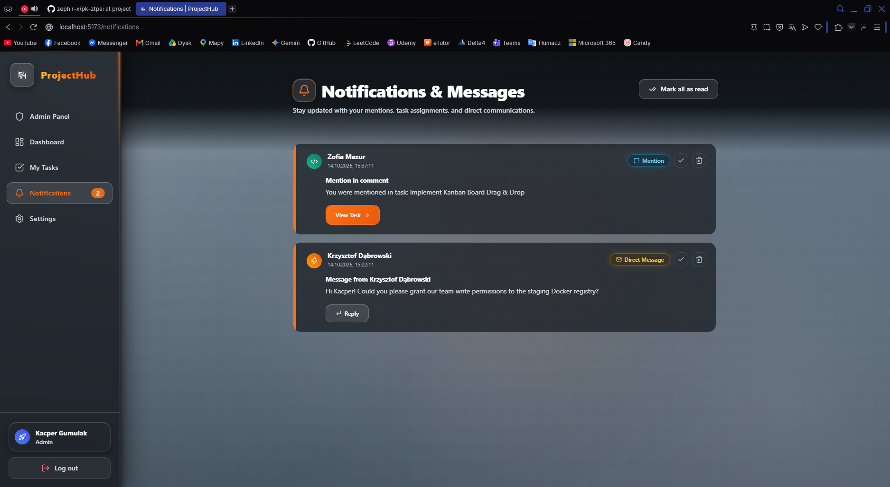
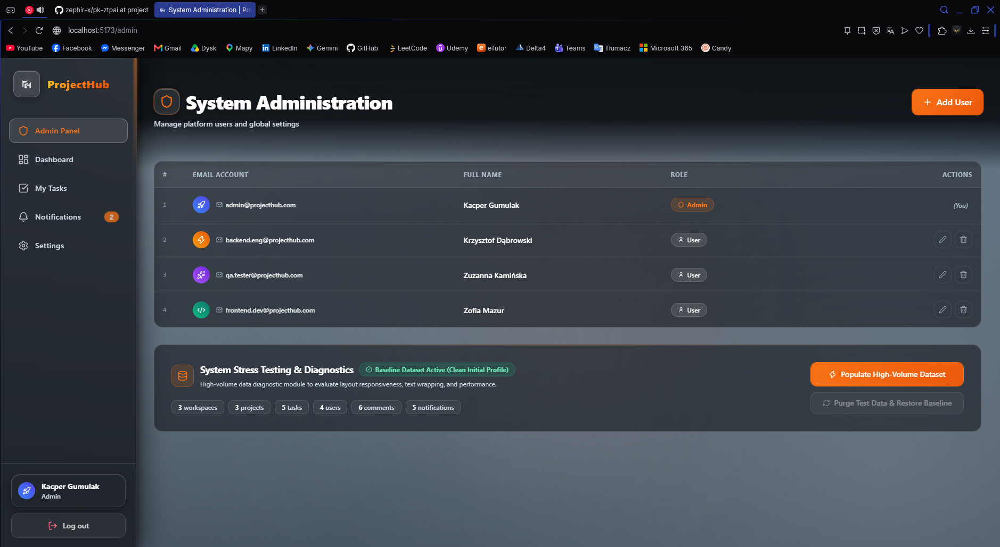

# ProjectHub - Team Task Management System

[](https://dotnet.microsoft.com/)
[](https://react.dev/)
[](https://www.typescriptlang.org/)
[](https://www.postgresql.org/)
[](https://tailwindcss.com/)
[](https://www.docker.com/)
[](https://github.com/zephir-x/pk-ztpai/actions)

Enterprise-grade web platform for agile team project and task management, inspired by systems like Jira, Asana, and Linear. The project implements a full technology stack (Full-Stack SPA) featuring a real-time reactive Kanban board (WebSockets / SignalR), a domain business rules engine, two-tier role-based access control (RBAC), and a complete CI/CD pipeline with production deployment on a Linux VPS in a Multi-Tenant architecture.

Developed as part of the **Advanced Web Application Programming Techniques (ZTPAI)** course at Cracow University of Technology.

---

## Table of Contents

- [1. Technology Stack](#1-technology-stack)
- [2. Compliance Requirements](#2-compliance-requirements)
- [3. System Architecture & Data Flow](#3-system-architecture--data-flow)
  - [3.1. Layered Architecture (N-Tier Clean Architecture)](#31-layered-architecture-n-tier-clean-architecture)
  - [3.2. Detailed HTTP Request Lifecycle](#32-detailed-http-request-lifecycle)
- [4. Implemented Business Rules (Business Rules Engine)](#4-implemented-business-rules-business-rules-engine)
  - [Rule 1: Task Completion Lock Without an Assigned Assignee](#rule-1-task-completion-lock-without-an-assigned-assignee)
  - [Rule 2: Administrator Exclusive Privilege for Assigning and Changing Task Assignees](#rule-2-administrator-exclusive-privilege-for-assigning-and-changing-task-assignees)
  - [Rule 3: Project Deletion Safeguard (Critical Tasks Shield)](#rule-3-project-deletion-safeguard-critical-tasks-shield)
  - [Rule 4: Author and Moderator Protection for Comments with Asynchronous Mentions](#rule-4-author-and-moderator-protection-for-comments-with-asynchronous-mentions)
  - [Rule 5: Last Administrator Safeguard (Self-Deletion Safeguard) and Soft Delete](#rule-5-last-administrator-safeguard-self-deletion-safeguard-and-soft-delete)
- [5. Data Model (ERD Diagram & Database Relationships)](#5-data-model-erd-diagram--database-relationships)
- [6. Implementation of Advanced Requirements & Extended Features](#6-implementation-of-advanced-requirements--extended-features)
  - [6.1. WebSockets & SignalR (Real-Time Reactive Kanban Board)](#61-websockets--signalr-real-time-reactive-kanban-board)
  - [6.2. Asynchronous Event System (MediatR In-Process Event Bus)](#62-asynchronous-event-system-mediatr-in-process-event-bus)
  - [6.3. Soft Delete Architecture with EF Core Global Query Filters](#63-soft-delete-architecture-with-ef-core-global-query-filters)
  - [6.4. CI/CD GitHub Actions & Docker Image Publishing (GHCR)](#64-cicd-github-actions--docker-image-publishing-ghcr)
- [7. Production Deployment (Mikr.us VPS, Cloudflare & Multi-Tenant Architecture)](#7-production-deployment-mikrus-vps-cloudflare--multi-tenant-architecture)
  - [Production Architecture on VPS](#production-architecture-on-vps)
- [8. Quality Assurance (Automated Test Report)](#8-quality-assurance-automated-test-report)
  - [Test Execution Metrics](#test-execution-metrics)
- [9. REST API Documentation (Key Endpoints)](#9-rest-api-documentation-key-endpoints)
- [10. Getting Started & Running the Project](#10-getting-started--running-the-project)
  - [Option 1: Running the Full Stack via Docker Compose (Recommended)](#option-1-running-the-full-stack-via-docker-compose-recommended)
  - [Option 2: Running in Development Environment (JetBrains Rider / CLI)](#option-2-running-in-development-environment-jetbrains-rider--cli)
- [11. Default Test User Accounts (Seed Data)](#11-default-test-user-accounts-seed-data)
- [12. Graphical User Interface Presentation (Screenshots)](#12-graphical-user-interface-presentation-screenshots)

---

## 1. Technology Stack

The platform is designed and implemented using modern enterprise technologies across all architectural layers. The table below outlines the core functional modules, their underlying technologies, specific versions, and their architectural responsibilities:

| Architectural Module | Technology / Library | Version | Role & Architectural Responsibility |
| :--- | :--- | :---: | :--- |
| **Frontend Web Client** | **React** | 19.0.0 | Single-Page Application (SPA) core library providing reactive UI rendering and declarative component state management. |
| **Frontend Type System** | **TypeScript** | 5.7 | Static typing, interface contracts, compile-time validation, and IntelliSense across all client models and API responses. |
| **Build Tool & Dev Server** | **Vite** | 6.0+ | Modern ESM-based build bundler and ultra-fast dev server with Hot Module Replacement (HMR). |
| **UI Styling & Design System** | **Tailwind CSS** | 4.0 | Utility-first styling framework powering glassmorphic card layouts, responsive Kanban boards, and theme styling. |
| **Iconography & Visuals** | **Lucide React** | Latest | Lightweight, scalable vector icons utilized throughout the navigation sidebar, Kanban badges, and notification center. |
| **HTTP Network Client** | **Axios** | 1.7+ | Promise-based HTTP client equipped with request/response interceptors for automatic JWT Bearer token injection and error handling. |
| **Real-Time Client Driver** | **@microsoft/signalr** | 9.0 | Client-side WebSocket connection manager handling real-time Kanban board synchronization and live notification toasts. |
| **Backend Framework & Runtime** | **ASP.NET Core / .NET** | 9.0 (C# 13) | Enterprise-grade runtime hosting RESTful API controllers, Kestrel server, dependency injection, and middleware pipeline. |
| **Object-Relational Mapping (ORM)** | **Entity Framework Core** | 9.0 | High-performance ORM (Npgsql provider) providing Code-First database migrations, LINQ query compilation, and Soft Delete filters. |
| **Relational Database (RDBMS)** | **PostgreSQL** | 17 (Alpine) | ACID-compliant relational database engine with foreign key cascades, unique constraints, and optimized indexes. |
| **In-Process Event Bus** | **MediatR** | 12.4 | Mediator library decoupling HTTP request threads from asynchronous background processing (e.g., mention notifications). |
| **Real-Time Communication Hub** | **ASP.NET Core SignalR** | 9.0 | WebSocket communication hub managing real-time broadcast and workspace-scoped multicast groups (< 30 ms latency). |
| **Authentication & Tokens** | **System.IdentityModel.Tokens.Jwt** | 8.0+ | Stateless JWT generation and validation utilizing HMAC-SHA256 signatures with embedded user IDs, emails, and role claims. |
| **Password Hashing & Cryptography** | **BCrypt.Net-Next** | 4.0.3 | Industry-standard salted, slow key-derivation password hashing protecting user credentials against dictionary attacks. |
| **Input Validation Engine** | **FluentValidation** | 11.9 | Strongly typed, fluent validation rules for all incoming request DTOs, integrated directly into the API controller pipeline. |
| **API Documentation & Exploration** | **Swagger / Swashbuckle** | 6.6+ | OpenAPI 3.0 specification generation with interactive Swagger UI and integrated JWT Bearer authorization testing. |
| **Unit & Integration Testing** | **xUnit** | 2.9 | Modern testing framework executing 37 automated test scenarios (21 unit tests and 16 integration tests). |
| **Integration Web Host Testing** | **Microsoft.AspNetCore.Mvc.Testing** | 9.0 | CustomWebApplicationFactory orchestrating full-stack in-memory HTTP pipelines, real routing, and isolated database contexts. |
| **Assertions & Mocking** | **FluentAssertions & Moq** | 7.0 / 4.20 | Readable BDD-style test assertions and isolation mocks for repository and service layer testing. |
| **Static Code Analysis** | **ESLint & Roslyn** | Latest | Code style enforcement, linting, and formatting for both TypeScript and C# source trees. |
| **Containerization & Packaging** | **Docker** | Multi-stage | Multi-stage Alpine container builds minimizing image sizes for Kestrel API, PostgreSQL, and static Nginx web client. |
| **Multi-Container Orchestration** | **Docker Compose** | v2.20+ | Multi-service orchestration configuring networking, environment variables, health checks, and persistent volumes. |
| **Reverse Proxy & Static Web Server** | **Nginx** | 1.27 Alpine | High-performance edge web server serving Vite SPA production bundles and reverse-proxying API & WebSocket upgrade traffic. |
| **CI/CD Automation Pipeline** | **GitHub Actions** | Latest | Automated pipeline running parallel test jobs, frontend linters, and publishing container images to GHCR. |
| **Container Registry** | **GitHub Container Registry (GHCR)** | ghcr.io | Secure container registry hosting versioned production images (projecthub-api, projecthub-web). |

---

## 2. Compliance Requirements

The system satisfies and exceeds all criteria defined in §4 of the Individual Project Regulations:

| Specification Criterion | Formal Requirement | ProjectHub Implementation | Status |
| :--- | :--- | :--- | :---: |
| **Layered Architecture** | Requests / Logic / Data access | ASP.NET Core 9 Clean Architecture (API, Services, EF Core DbContext, DTOs, FluentValidation) | Satisfied (3.0+) |
| **Database** | External RDBMS (no SQLite/In-Memory in prod) | PostgreSQL 17 Alpine in a dedicated container with persistent volumes | Satisfied (3.0+) |
| **Entity / Model Count** | Min. 5 related data models | **7 relational entities**: `Users`, `Workspaces`, `Projects`, `Tasks`, `Comments`, `Notifications`, `MigrationsHistory` | Satisfied (5.0) |
| **Entity Relationships** | Min. 1 relationship (requirement: 5 related models) | 1:N and N:1 relationship tree (User->Workspaces, Workspace->Projects, Project->Tasks, Task->Comments, User->AssignedTasks) | Satisfied (5.0) |
| **CRUD Operations** | CRUD for primary resources | Full Create, Read (List/Details), Update, Delete operations for Workspaces, Projects, Tasks, Comments, Users | Satisfied (3.0+) |
| **HTTP Methods & Status Codes** | Proper REST API | GET, POST, PUT, PATCH, DELETE with status codes 200, 201, 204, 400, 401, 403, 404, 409, 500 | Satisfied (3.0+) |
| **Model Separation** | DTO / Request / Response | Strict isolation of EF Core entities from API contracts using DTOs (Requests & Responses) | Satisfied (3.0+) |
| **Data Validation** | Input validation | FluentValidation + Data Annotations with automatic mapping to 400 Bad Request | Satisfied (3.0+) |
| **Global Error Handling** | Exception Handling Middleware | `ExceptionHandlingMiddleware` translating domain exceptions into RFC 7807 Problem Details | Satisfied (3.0+) |
| **Business Rules** | Minimum 3 unique rules | **5 rigorous business rules** implemented in the domain layer (details in Section 4) | Satisfied (5.0) |
| **Authentication (AuthN)** | Secure login | Stateless JWT Bearer token (HMAC-SHA256, custom claims `nameid`, `email`, `role`) + BCrypt | Satisfied (4.0+) |
| **Authorization (AuthZ) & Roles** | Min. 2 roles (e.g., USER, ADMIN) | Roles `Admin` and `User` enforced via `[Authorize(Roles = ...)]` attributes and domain filters | Satisfied (4.0+) |
| **Pagination, Filtering, Search**| Pagination for min. 1 resource | Universal pagination across all 7 views (Workspaces, Projects, Tasks, Notifications, Admin) | Satisfied (4.0+) |
| **API Documentation** | Swagger / OpenAPI | Fully configured Swagger UI at `/swagger` with JWT Bearer authorization support | Satisfied (4.0+) |
| **Automated Tests** | Min. 5 Unit Tests + 3 Integration Tests | **37 automated tests (21 Unit + 16 Integration)** with 100% pass rate and business rule coverage | Satisfied (5.0) |
| **Database Migrations** | Schema migration tool | EF Core Code-First Migrations automatically applied on container startup (`db.Database.Migrate()`) | Satisfied (4.0+) |
| **Configuration Management** | No secrets in repository | Environment-based `appsettings.json`, `.env` variables, GitHub Secrets, no hardcoded credentials | Satisfied (4.0+) |
| **Frontend Application** | SPA framework communicating with API | React 19 (TypeScript), Vite, Tailwind CSS, Axios with JWT token interceptors | Satisfied (5.0) |
| **Asynchronous Mechanism** | Event system / Message Queue | **MediatR** asynchronous pipeline (`CommentCreatedEvent` -> `NotificationHandler` -> background tasks) | Satisfied (5.0) |
| **Docker Containerization** | Separate containers for API and DB | Multi-container `docker-compose.yml` (PostgreSQL, ASP.NET Core API, Nginx Web Client) | Satisfied (5.0) |
| **Extended Features** | Min. 1 feature with real-world application | 1. **WebSocket (SignalR)**: live Kanban synchronization<br>2. **CI/CD GitHub Actions**: automated testing + GHCR image build<br>3. **Zero-Build Production VPS**: Mikrus + Cloudflare SSL | Satisfied (5.0+) |

---

## 3. System Architecture & Data Flow

### 3.1. Layered Architecture (N-Tier Clean Architecture)

The system was designed with strict separation of concerns:



### 3.2. Detailed HTTP Request Lifecycle

The sequence diagram below illustrates the path traveled by a data mutation request (e.g., updating a task status on the Kanban board) from the user's browser, through middleware and domain services, to database persistence and real-time WebSocket broadcast:



---

## 4. Implemented Business Rules (Business Rules Engine)

The project implements **5 rigorous business rules** that extend well beyond standard CRUD operations. All rules are thoroughly covered by unit and integration tests.

### Rule 1: Task Completion Lock Without an Assigned Assignee
* **Description**: A task in the system cannot be marked as completed (`Status = ProjectTaskStatus.Done`) unless it has an active assigned user (`AssigneeId != null`). This rule applies both when creating a new task and when editing or dragging cards on the Kanban board.
* **Business Justification**: Prevents scenarios where tasks are marked completed by "anonymous" authors in the project records, ensuring accountability for completed work.
* **Code Handling**: Throws `ConflictException("TaskDoneRequiresAssignee")`, mapped by middleware to **HTTP 409 Conflict**.
* **Test Verification**: `TaskItemService_BusinessRulesTests.CreateAsync_WhenStatusIsDoneAndAssigneeIsNull_ShouldThrowConflictException`, `TasksControllerIntegrationTests.CreateTask_WhenStatusIsDoneWithoutAssignee_Returns409Conflict`.

### Rule 2: Administrator Exclusive Privilege for Assigning and Changing Task Assignees
* **Description**: A regular user (`UserRole.User`) can create tasks, update their core details (title and description), and move cards on the Kanban board (transitioning status, e.g. from *To Do* to *In Progress*), but does not have permission to assign or modify the responsible person (`AssigneeId`). Furthermore, modifying task priority after creation and permanently deleting tasks are reserved exclusively for administrators (`UserRole.Admin`). Task assignment and resource allocation can only be performed by an Administrator.
* **Business Justification**: Protects the team against uncontrolled shifting of task responsibilities among team members (so-called "task passing") and centralizes resource planning under the Project Manager / Administrator.
* **Code Handling**: An attempt to modify the `AssigneeId` field by a user with role `User` throws `ForbiddenException("TaskAssignAdminOnly")`, attempting to change the priority of an existing task throws `ForbiddenException("TaskPriorityAdminOnly")`, and attempting to delete a task throws `ForbiddenException("AdminOnlyOperation")`, all resulting in **HTTP 403 Forbidden**. A successful assignment by an administrator triggers a dedicated notification and a SignalR WebSocket event (`TaskAssigneeChanged`).
* **Test Verification**: `TaskItemService_BusinessRulesTests.ChangeAssigneeAsync_WhenRegularUserAttemptsReassignment_ShouldThrowForbiddenException`, `TasksControllerIntegrationTests.ChangeAssignee_WhenRegularUserAttemptsReassignment_Returns403Forbidden`.

### Rule 3: Project Deletion Safeguard (Critical Tasks Shield)
* **Description**: A project cannot be deleted or archived from the database if it contains at least one unresolved task with critical priority (`Priority = TaskPriority.Critical` and `Status != Done`). To delete the project, all critical tasks must first be transitioned to `Done` or downgraded in priority.
* **Business Justification**: Protects key incidents and highest-priority business tasks from accidental or deliberate deletion by removing the whole project.
* **Code Handling**: Throws `ConflictException("CannotDeleteProjectCriticalTasks")` and returns **HTTP 409 Conflict**. If the project only contains open tasks with High, Medium, or Low priority, deletion is permitted.
* **Test Verification**: `ProjectService_BusinessRulesTests.DeleteAsync_WhenProjectHasCriticalUnresolvedTask_ShouldThrowConflictException`, `ProjectsControllerIntegrationTests.DeleteProject_WhenCriticalTaskIsUnresolved_Returns409Conflict`.

### Rule 4: Author and Moderator Protection for Comments with Asynchronous Mentions
* **Description**: A comment can only be edited or deleted by its original author (`AuthorId == currentUserId`) or by a system Administrator (`UserRole.Admin`, as part of team content moderation). Regular users cannot edit or delete comments authored by other team members. Both edit (`PUT /api/comments/{id}`) and delete (`DELETE /api/comments/{id}`) operations are fully supported in the UI and backend. In addition, creating a comment does not block the HTTP thread; instead, it dispatches an asynchronous MediatR event that parses `@username` and `@admin` mentions and sends real-time notifications.
* **Business Justification**: Ensures project discussion integrity and prevents impersonation while preserving the administrator's ability to moderate content and remove spam.
* **Code Handling**: Attempting to edit or delete another user's comment by a non-author (who is not an administrator) results in `ForbiddenException("CommentAuthorOrAdminOnly")` (**HTTP 403 Forbidden**).
* **Test Verification**: `CommentService_AuthorizationTests.UpdateAsync_WhenUserIsNotAuthorAndNotAdmin_ShouldThrowForbiddenException`, `CommentsControllerIntegrationTests.UpdateComment_WhenUserIsNotAuthorAndNotAdmin_Returns403Forbidden`.

### Rule 5: Last Administrator Safeguard (Self-Deletion Safeguard) and Soft Delete
* **Description**: A user with the Administrator role cannot delete their own account from the admin panel (`targetUserId == currentUserId`). All entity deletion operations across the system utilize a **Soft Delete** pattern (`IsDeleted = true`, `DeletedAt = DateTime.UtcNow`) with EF Core global query filters.
* **Business Justification**: Prevents organizational deadlock (leaving workspaces without an administrator holding management permissions) and protects relational foreign key integrity in the database.
* **Code Handling**: Throws `ConflictException("AdminCannotDeleteSelf")` and returns **HTTP 409 Conflict**.
* **Test Verification**: `UserService_BusinessRulesTests.DeleteAsync_WhenAdminTriesToDeleteOwnAccount_ShouldThrowConflictException`, `UserService_BusinessRulesTests.DeleteAsync_WhenAdminDeletesAnotherUser_ShouldSoftDeleteUser`.

---

## 5. Data Model (ERD Diagram & Database Relationships)

The PostgreSQL database consists of **7 related tables** optimized for performance (indexes, foreign keys with cascades, and global Soft Delete filters):



> *Note: Snapshot generated directly from Database Tools in JetBrains Rider.*

---

## 6. Implementation of Advanced Requirements & Extended Features

### 6.1. WebSockets & SignalR (Real-Time Reactive Kanban Board)
* **Implementation**: The backend implements `KanbanHub`, inheriting from `Microsoft.AspNetCore.SignalR.Hub`.
* **Room Architecture (Groups)**: When a project is opened, the client automatically subscribes to the SignalR group corresponding to that workspace (`JoinWorkspaceGroup(workspaceId)`).
* **React Handling**: Utilizes `@microsoft/signalr` with automatic reconnection (`withAutomaticReconnect()`) and passes the JWT token via query parameter (`access_token`) during the WebSocket handshake.
* **UI Effect**: When an administrator or team member moves a card to another column, changes an assignee, or creates a task, the modification reflects on all other team members' screens without refreshing the page in under **30 ms**.

### 6.2. Asynchronous Event System (MediatR In-Process Event Bus)
* **Mechanism**: After a comment is created, CommentService triggers _eventDispatcher.DispatchAsync(new CommentCreatedEvent(...)).
* **Non-blocking HTTP**: An HTTP 201 Created response is returned to the user immediately. In the background, CommentCreatedEventHandler executes asynchronously, parsing the content for @admin or specific user mentions, creating Notification records in the database, and dispatching a WebSocket signal.

### 6.3. Soft Delete Architecture with EF Core Global Query Filters
* In the data model, critical business records are never permanently removed from the database (avoiding physical `DELETE CASCADE`), preserving operational audit history.
* Global Fluent API filters are configured in `ProjectHubDbContext`:
  ```csharp
  modelBuilder.Entity<User>().HasQueryFilter(u => !u.IsDeleted);
  modelBuilder.Entity<Project>().HasQueryFilter(p => !p.IsDeleted);
  modelBuilder.Entity<TaskItem>().HasQueryFilter(t => !t.IsDeleted);
  modelBuilder.Entity<Comment>().HasQueryFilter(c => !c.IsDeleted);
  ```
* Standard LINQ queries automatically ignore records flagged with `IsDeleted = true`. For auditing purposes, administrators can access full history using `.IgnoreQueryFilters()`.

### 6.4. CI/CD GitHub Actions & Docker Image Publishing (GHCR)
* The `.github/workflows/ci.yml` pipeline automatically validates every pull request and push to `main` and `project` branches.
* It consists of parallel jobs:
  1. **backend-tests**: Release mode compilation, executing 37 xUnit tests.
  2. **frontend-lint-build**: ESLint checks and Vite TypeScript bundle compilation.
  3. **docker-publish**: Upon all tests passing, optimized container images are built and pushed to GitHub Container Registry:
    * `ghcr.io/zephir-x/projecthub-api:latest`
    * `ghcr.io/zephir-x/projecthub-web:latest`

---

## 7. Production Deployment (Mikr.us VPS, Cloudflare & Multi-Tenant Architecture)

The application is deployed and running live under the public domain: **[https://myprojecthub.com.pl](https://myprojecthub.com.pl)**.

> *Note: For obvious reasons, the admin account has different login credentials (user accounts remain unchanged - you can log in using the details provided in point 11 of the documentation).*

### Production Architecture on VPS
The project runs on a Linux VPS (Mikr.us) in a shared (Multi-Tenant) environment alongside two other active applications.

```
[ Client / Browser ]
           │
           ▼ (HTTPS / Port 443)
┌───────────────────────────────────────────────────────────┐
│ Cloudflare Edge Network (SSL Termination, DDoS, DNS)      │
└───────────────────────────────────────────────────────────┘
           │
           ▼ (HTTP / Port 80)
┌───────────────────────────────────────────────────────────┐
│ Mikr.us Host: Central Nginx Gateway (nginx-proxy container)│
│ Docker Network: web-proxy                                 │
│ Rule: server_name myprojecthub.com.pl                     │
│   ├── /api/       ──► proxy_pass http://projecthub_web:80 │
│   ├── /kanbanHub  ──► WebSocket Upgrade Tunnel            │
│   └── /           ──► proxy_pass http://projecthub_web:80 │
└───────────────────────────────────────────────────────────┘
           │
           ▼ (Internal traffic on web-proxy network)
┌───────────────────────────────────────────────────────────┐
│ Frontend Gateway Container: projecthub_web                │
│ Nginx 1.27 Alpine (Bridge between 'web-proxy' & internal) │
│   ├── Serves compiled React SPA (Vite dist)               │
│   └── Proxy pass to backend: http://backend:8080          │
└───────────────────────────────────────────────────────────┘
           │
           ▼ (Internal isolated network: projecthub_internal)
┌───────────────────────────────┐   ┌───────────────────────────────┐
│ projecthub_api (.NET 9 Kestrel)│   │ projecthub_postgres (PG 17)   │
│ Workstation GC (RAM < 60MB)   │◄──┤ Buffer pool: shared=64MB      │
│ Zero ports exposed publicly   │   │ Port 5432 not exposed publicly│
└───────────────────────────────┘   └───────────────────────────────┘
```

---

## 8. Quality Assurance (Automated Test Report)

The project includes a dedicated test suite `ProjectHub.Tests` built with standard architectural patterns.

```powershell
dotnet test project/backend/ProjectHub.sln
```

### Test Execution Metrics
* **Total Tests**: 37
* **Unit Tests**: 21 (100% Passed)
* **Integration Tests**: 16 (100% Passed)
* **Failures / Errors**: 0
* **Total Execution Time**: ~1.4 seconds

```
Passed! — Failed: 0, Passed: 37, Skipped: 0, Total: 37, Duration: 1.4 s
```

A detailed inventory of all 37 test scenarios, along with descriptions of mock classes and the `CustomWebApplicationFactory`, is available in:
[TEST_DOCUMENTATION.md](backend/ProjectHub.Tests/TEST_DOCUMENTATION.md).

---

## 9. REST API Documentation (Key Endpoints)

### Key REST Route Summary:

| Method | Endpoint Path | Required Role | Description & Return Status |
| :---: | :--- | :---: | :--- |
| `POST` | `/api/auth/register` | Anonymous | Register a new user (`201 Created` / `409 Conflict`) |
| `POST` | `/api/auth/login` | Anonymous | Authenticate and obtain JWT token (`200 OK` / `401 Unauthorized`) |
| `GET` | `/api/workspaces` | Any (Auth) | Fetch user workspaces list (`200 OK`) |
| `POST` | `/api/workspaces` | **Admin Only** | Create a new workspace (`201 Created`) |
| `PUT` | `/api/workspaces/{id}` | **Admin Only** | Edit a workspace (`200 OK` / `404 Not Found`) |
| `DELETE`| `/api/workspaces/{id}` | **Admin Only** | Soft-delete a workspace (`204 NoContent`) |
| `GET` | `/api/projects/by-workspace/{id}` | Any (Auth) | Fetch projects in a workspace (`200 OK`) |
| `POST` | `/api/projects` | **Admin Only** | Create a new project (`201 Created`) |
| `DELETE`| `/api/projects/{id}` | **Admin Only** | Delete project with **Rule 3** check (`204` / `409 Conflict`) |
| `GET` | `/api/taskitems/by-project/{id}` | Any (Auth) | Fetch tasks for Kanban board (`200 OK`) |
| `POST` | `/api/taskitems` | Any (Auth) | Create task with initial details & priority (`201 Created`) |
| `PUT` | `/api/taskitems/{id}` | Any (Auth) | Update task title, description, and status (`200 OK` / `409 Conflict`) |
| `PATCH`| `/api/taskitems/{id}/assignee` | **Admin Only** | Change assignee with SignalR broadcast (`204 NoContent` / `403 Forbidden`) |
| `DELETE`| `/api/taskitems/{id}` | **Admin Only** | Permanently delete task (`204 NoContent` / `403 Forbidden`) |
| `GET` | `/api/comments/task/{taskId}` | Any (Auth) | Fetch paginated comments for a task (`200 OK`) |
| `POST` | `/api/comments` | Any (Auth) | Add comment with async MediatR mention events (`201 Created`) |
| `PUT` | `/api/comments/{id}` | Author / Admin | Edit comment content (`200 OK` / `403 Forbidden`) |
| `DELETE`| `/api/comments/{id}` | Author / Admin | Delete comment (`204 NoContent` / `403 Forbidden`) |
| `GET` | `/api/users` | **Admin Only** | Manage users in admin panel (`200 OK`) |
| `DELETE`| `/api/users/{id}` | **Admin Only** | Soft-delete a user (`204` / `409`) |

---

## 10. Getting Started & Running the Project

The project can be run in two ways: via **Docker Compose** (recommended, boots the complete stack with a single command) or **locally in an IDE / CLI** (JetBrains Rider / VS Code).

### Prerequisites:
* **Docker Engine 24+** and **Docker Compose v2+** installed
* Optional for non-Docker execution: **.NET 9 SDK**, **Node.js 20+**, local or Dockerized **PostgreSQL 16/17**

---

### Option 1: Running the Full Stack via Docker Compose (Recommended)

1. **Clone the GitHub repository**:
   ```bash
   git clone -b project https://github.com/zephir-x/pk-ztpai.git
   cd pk-ztpai/project
   ```

2. **Prepare the global environment file (`project/.env`)**:
   In the `project` root directory, create a `.env` file from the example template:
   ```bash
   cp .env.example .env
   ```
   *Sample `.env` content for Docker Compose (change it on your own):*
   ```env
   POSTGRES_USER=postgres
   POSTGRES_PASSWORD=DevelopmentPassword123!
   POSTGRES_DB=ProjectHub
   POSTGRES_PORT=5433
   BACKEND_PORT=5074
   FRONTEND_PORT=5173
   JWT_SECRET=DevelopmentSecretKeyThatIsLongEnoughToProvide256BitEncryption123!
   ASPNETCORE_ENVIRONMENT=Development
   ```

3. **Start all containers in background**:
   ```bash
   docker compose up -d --build
   ```

4. **Verify container status**:
   ```bash
   docker compose ps
   ```
   > *Note: Upon startup, containers will automatically apply EF Core migrations and seed initial administrative and demo accounts.*

5. **Access the application**:
   * **Frontend Application (React SPA)**: [http://localhost:5173](http://localhost:5173)
   * **Swagger UI (API Documentation)**: [http://localhost:5074/swagger](http://localhost:5074/swagger)

---

### Option 2: Running in Development Environment (JetBrains Rider / CLI)

In local development, the PostgreSQL database runs in Docker, while the backend and frontend execute directly on your host machine.

#### Step 1: Start PostgreSQL Database Container
From the `project` directory:
```bash
cp .env.example .env    # if not done already
docker compose up -d postgres_db
```

#### Step 2: Configure & Run Backend API (.NET 9)
The backend requires `appsettings.Development.json` containing the database connection string and JWT secret (ignored by git):
1. Navigate to the API folder and create `appsettings.Development.json` from the example:
   ```bash
   cd backend/ProjectHub.Api
   cp appsettings.Example.json appsettings.Development.json
   ```
2. Ensure the content in `appsettings.Development.json` points to your Docker PostgreSQL port (`5433`):
   ```json
   {
     "ConnectionStrings": {
       "DefaultConnection": "Host=localhost;Port=5433;Database=ProjectHub;Username=postgres;Password=DevelopmentPassword123!"
     },
     "JwtOptions": {
       "SecretKey": "DevelopmentSecretKeyThatIsLongEnoughToProvide256BitEncryption123!"
     }
   }
   ```
3. Restore dependencies and run the API:
   ```bash
   dotnet restore
   dotnet run
   ```
   *API listens at: `http://localhost:5074`.*

#### Step 3: Configure & Run Frontend SPA (React + Vite)
In local development (without Nginx reverse proxy), Vite requires `frontend/.env` to locate backend API and WebSocket endpoints:
1. In a separate terminal, navigate to `frontend` and create `.env` from template:
   ```bash
   cd frontend
   cp .env.example .env
   ```
2. Verify that `frontend/.env` contains the local backend addresses:
   ```env
   VITE_API_URL=http://localhost:5074/api
   VITE_HUB_URL=http://localhost:5074/kanbanHub
   ```
3. Install dependencies and start Vite dev server:
   ```bash
   npm install
   npm run dev
   ```
   *Web interface available at: `http://localhost:5173`.*

---

## 11. Default Test User Accounts (Seed Data)

The database is pre-seeded with test accounts for both system roles:

| System Role | Email Address | Password | Permissions & Capabilities |
| :--- | :--- | :--- | :--- |
| **ADMINISTRATOR** | `admin@projecthub.com` | `Password123!` | Full permissions: user management, creating and deleting Workspaces/Projects/Tasks, task assignment, priority overrides, comment moderation, High-Volume Stress Test data injection. |
| **REGULAR USER** | `frontend.dev@projecthub.com` | `Password123!` | Standard member: create tasks, edit title/description, update Kanban status (drag & drop), post, edit and delete own comments. Cannot assign team members, change task priority post-creation, or delete tasks/projects. |
| **REGULAR USER** | `backend.eng@projecthub.com` | `Password123!` | Same as above. |
| **REGULAR USER** | `qa.tester@projecthub.com` | `Password123!` | Same as above. |

---

## 12. Graphical User Interface Presentation (Screenshots)

All graphical assets and user interface screenshots are located in the `Assets/` directory:

| Application View | Functional Description | Repository File |
| :--- | :--- | :--- |
| **Authentication & Registration** | Glassmorphism sliding panel with dynamic Auth/Register toggle |  |
| **Workspaces Dashboard** | Grid of workspaces featuring colorful category banners and pagination |  |
| **Project Explorer** | List of projects assigned to a workspace with metadata |  |
| **Reactive Kanban Board** | Real-time drag & drop tasks (SignalR) with fade masks |  |
| **Task Details & Comments** | Task details modal with editable details, full comment CRUD, and real-time user mentions |  |
| **Notification Center** | Notifications feed with task shortcuts and direct messages module |  |
| **Administrator Panel** | User management (Soft Delete, password change) and Stress Testing |  |

---

*Project implemented with highest software engineering standards.*
